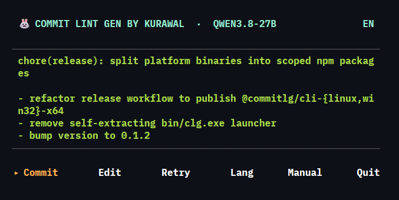

# clg



A terminal UI tool that generates commit messages following the [Conventional Commits](https://www.conventionalcommits.org/) standard — straight from your staged `git diff`, so you don't have to think about the format every time you commit.

Developers often write lazy commit messages ("fix bug", "update", "wip") because getting the format right takes time and effort. `clg` reads your staged changes and generates a draft commit message powered by AI (Groq + Qwen3.8-27B by default).

## Key Features

- **AI-powered generation** — reads `git diff --staged` and produces a Conventional Commits draft automatically
- **Heuristic fallback** — path/stat-based generation when there is no API key or the AI call fails
- **Interactive TUI** — accept, edit, retry, or write manual commits from a keyboard-driven interface
- **Lint & git hook** — validate messages with `clg lint`, enforce them automatically with `clg init`
- **History audit** — check recent commits for conventional-compliance with `clg audit`
- **Doctor command** — diagnose git, config, API key, and API connectivity
- **Multi-language** — generate commit messages in English or Bahasa Indonesia
- **Flexible AI providers** — works with any OpenAI-compatible provider (Groq, OpenAI, local Ollama, etc.)
- **Rate-limit handling** — respects `try again in Ns` responses from Groq with automatic retry
- **Simple configuration** — provider, model, language, and lint rules in a single `~/.commitlintgenrc.json`
- **Single static binary** — no runtime required, instant startup (~3 MiB memory)

## Tech Stack

| Category         | Technology                                                    |
|------------------|---------------------------------------------------------------|
| Language         | Rust (edition 2024)                                           |
| Package manager  | Cargo                                                         |
| Terminal UI      | [ratatui](https://github.com/ratatui-org/ratatui) + [crossterm](https://github.com/crossterm-rs/crossterm) |
| HTTP client      | [reqwest](https://github.com/seanmonstar/reqwest) (rustls)   |
| AI client        | OpenAI-compatible (default: [Groq](https://groq.com/) + Qwen3.8-27B) |
| Text width       | [unicode-width](https://github.com/unicode-rs/unicode-width) |

## Supported Platforms

Prebuilt **Rust binaries** are attached to [GitHub Releases](https://github.com/kurawal-creative/commit-lint-gen/releases). The `commitlg` package is published to npm without binaries; its `postinstall` script downloads the matching asset for your platform from the release that matches the installed version (beta versions use the prerelease channel) and exposes it as `bin/clg.exe` — a native executable on every OS despite the `.exe` suffix. No Node.js runtime is needed at execution time.

| Platform        | Architecture | Install command           |
|-----------------|--------------|---------------------------|
| Linux           | x86_64       | `npm i -g commitlg`       |
| Windows         | x86_64       | `npm i -g commitlg`       |

macOS builds are temporarily disabled while the release pipeline is being reworked; only Linux and Windows binaries are published for now.

Install a specific channel:

```bash
npm i -g commitlg          # stable, published from main
npm i -g commitlg@beta     # pre-release, published from beta
```

Build from source:

```bash
git clone https://github.com/dhodo999/commit-lint-gen.git
cd commit-lint-gen
cargo build --release
./target/release/clg
```

## Usage

### 1. Configure API key

```bash
clg config
```

This creates `~/.commitlintgenrc.json` with your Groq API key, model, and language preference.

### 2. Stage your changes and run

```bash
git add .
clg
```

The TUI opens with a generated commit message. Use the menu:

| Key | Action |
|-----|--------|
| **Enter** | Commit with the generated message |
| **e** | Edit the message |
| **r** | Retry — regenerate a new suggestion |
| **l** | Switch language (EN ↔ ID) |
| **m** | Manual mode — write your own commit message |
| **q** | Quit without committing |

Arrow keys **← →** navigate the menu. Arrow keys **↑ ↓** navigate inside the editor.

### Manual commit

Select **Manual** from the menu, type your commit message, and press Enter to commit directly.

## Commands

| Command | Description |
|---------|-------------|
| `clg` | Generate a message from staged changes and open the TUI |
| `clg generate [-y] [-H] [file]` | Explicit generate. `-y/--yes` auto-commits, `-H/--heuristic` skips AI, `file` is used by the git hook |
| `clg lint "<message>"` | Validate a message against the configured rules (exit `1` on errors) |
| `clg init` | Install the `commit-msg` hook in the current repository |
| `clg uninstall` | Remove the hook installed by `clg init` |
| `clg audit [-n N]` | Analyze the last N commits (default 20) for conventional compliance |
| `clg config` | Interactive API key/model setup |
| `clg doctor` | Check git, config, API key source, and API connection |
| `clg update [--check]` | Check npm for a newer release and install it (`--check` only reports) |
| `clg -v, --version` | Print version and repository URL |
| `clg -h, --help` | Show help |

Examples:

```bash
clg generate -y            # generate and commit without the TUI
clg generate -y -H         # auto-commit using heuristic only
clg lint "feat(api): add user authentication"
clg audit -n 50
clg init                   # then commit messages are linted automatically
```

If the API key is missing or the AI request fails, `clg` falls back to heuristic generation automatically.

### Updates

The binary embeds its current version and the `kurawal-creative/commit-lint-gen` repository. When installed via npm, it checks the npm registry at most once every 24 hours and silently runs `npm i -g commitlg@latest` when a newer release exists (pick it up on the next launch). Set `CLG_NO_UPDATE=1` to disable the background check, or run:

```bash
clg update           # check and install the latest release
clg update --check   # only report whether an update is available
clg --version        # clg 2.0.1 (github.com/kurawal-creative/commit-lint-gen)
```

## Configuration

The config file lives at `~/.commitlintgenrc.json`:

```json
{
  "aiProvider": "groq",
  "apiKey": "your_groq_api_key_here",
  "baseURL": "https://api.groq.com/openai/v1",
  "language": "en",
  "model": "qwen/qwen3.8-27b",
  "rules": {
    "maxLength": 100,
    "minLength": 10,
    "types": ["feat", "fix", "docs", "style", "refactor", "test", "chore", "ci"],
    "scopes": [],
    "requireScope": false
  },
  "diffProcessor": {
    "maxTotalChars": 8000,
    "ignoredExts": [".png", ".jpg", ".svg", ".pdf", ".zip", ".wasm", ".mp4"],
    "ignoreLocks": true
  }
}
```

- `rules` — used by `clg lint`, `clg audit`, and the installed git hook. `scopes` empty means any scope is allowed.
- `diffProcessor` — limits what is sent to the AI. Lockfiles and `ignoredExts` are skipped, and the diff is truncated at `maxTotalChars`.

**Using other AI providers:**

```json
{
  "apiKey": "your_api_key",
  "baseURL": "https://api.openai.com/v1",
  "model": "gpt-4o-mini"
}
```

Any OpenAI-compatible API works. Change `baseURL` and `model` to match your provider.

**API key from environment:** `GROQ_API_KEY` (or `apiKey`) is used when the config file has no key — handy for CI.

## Performance

| Metric                       | Value                    |
|------------------------------|--------------------------|
| Cold-start                   | < 5 ms                   |
| Resident memory (idle)       | ~3-5 MiB                 |
| Disk size (release, stripped)| ~3 MiB                   |
| System dependencies          | None                     |
| API latency (Groq, cold)     | ~400 ms                  |

## Contributing

This project is open source and welcomes contributions. Feel free to open an issue or pull request.

### Releasing

Publishing is fully automated — just push:

- Push/merge to `beta` → CI creates a GitHub prerelease tagged `vx.y.z-beta.n` and publishes `x.y.z-beta.n` to npm with the `beta` tag (`npm i -g commitlg@beta`). The core is always above the last stable release; `n` increments per beta publish.
- Push/merge to `main` → CI creates a GitHub release tagged `vx.y.z` and publishes a stable `x.y.z` to npm with the `latest` tag (`npm i -g commitlg`).

The release is created before the npm publish, so `postinstall` can download its assets immediately. Both npm and Git tags are checked when computing the next version.

`Cargo.toml` remains the version referenced in the repo, but CI injects the computed version into `Cargo.toml` and `package.json` before building/publishing, and the binary embeds it. A manual `version` bump in `Cargo.toml` is honored when it is higher. Workflow runs are serialized so two branches cannot publish the same version.

Because the channel is encoded in the version (`-beta.n`), auto-update stays on the same channel: beta installs update to the newest beta, stable installs update to the newest stable. `clg update` follows the same rule.

## License

MIT
